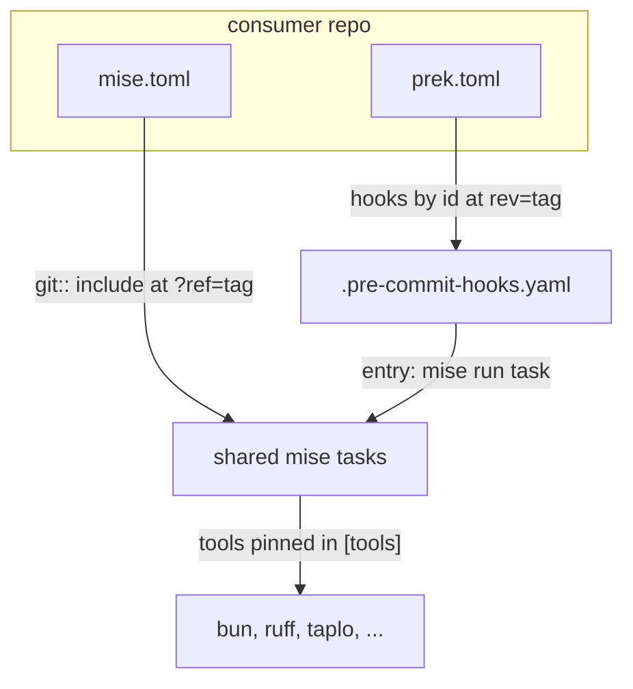

<div align="center">

<!-- docs-site-hero:start -->

<picture>
  <source media="(prefers-color-scheme: dark)" srcset="assets/logo-dark.svg">
  <source media="(prefers-color-scheme: light)" srcset="assets/logo-light.svg">
  
</picture>

# Shared Dev Tooling

**Shared mise tasks and prek hooks, released as one semver tag.**

<!-- docs-site-hero:end -->

[](https://mise.jdx.dev/)
[](https://github.com/j178/prek)
[](https://bun.sh/)
[](https://starlight.astro.build/)
[](https://git-cliff.org/)<br>
[](https://copier-templates.github.io/shared-dev-tooling/)
[](https://www.conventionalcommits.org/)
[](LICENSE)

</div>

Shared [mise](https://mise.jdx.dev/) tasks and [prek](https://prek.j178.dev) hooks: mise installs the tools, every hook is a thin `mise run <task>` wrapper, and both release under one semver tag.

## How it works

A consumer pins this repo at one tag in two places: a `git::` include in `mise.toml` provides the tasks, and a `[[repos]]` entry in `prek.toml` provides the hooks. Each hook's `entry` is `mise run <task>`, so the task is the single source of truth for the command and the tool version.



One tag drives both files. A hook resolves to a task, and the task calls a tool the consumer installed.

## Quick start

Three things, all pinned to the same tag:

1. Include the tasks in your `mise.toml`.
2. Pin the tools those tasks call in `[tools]`.
3. Add this repo to `prek.toml` with a `rev` and list hooks by `id`.

```toml
# mise.toml
min_version = "2026.11.10"

[settings]
experimental = true # required for git:: task includes
lockfile = true
minimum_release_age = "7d"

[task_config]
includes = [
  "git::https://github.com/copier-templates/shared-dev-tooling.git//tasks?ref=<tag>",
]

[tools]
# pin every tool the included tasks call, e.g.
"cargo:taplo-cli" = "0.10"
```

```toml
# prek.toml
[[repos]]
repo = "https://github.com/copier-templates/shared-dev-tooling"
rev = "<tag>"
hooks = [
  { id = "mise-lock-check" },
  { id = "taplo-lint" },
]
```

> [!TIP]
> Bump the mise `ref` and the prek `rev` together: run `prek update` (it respects `[update] cooldown_days`), then move `?ref=` to the same tag. Tasks and hooks never drift.

## Layout

| Path | Purpose |
| --- | --- |
| `.pre-commit-hooks.yaml` | prek hook manifest |
| `tasks/<category>/<tool>.tasks.toml` | shared mise tasks, named `<tool>:<verb>`; `tasks/core/gates.tasks.toml` defines the `gate:*` entry points, each aliased to its bare name |
| `tasks/<category>/<name>.sh` | shared file tasks, e.g. `release:cut` |
| `docs/guidelines/` | contributor guidelines (also rendered to the docs site) |
| `tasks/docs/starlight.tasks.toml` | shared docs site tasks (`docs:*`), powered by Astro/Starlight |
| `astro.config.mjs` | Starlight site config (repo-only) |
| `src/content.config.ts` | docs collection schema (repo-only) |
| `src/styles/` | site themes: dark + light, extensible (repo-only) |
| `scripts/docs-sync.sh` | syncs `docs/` + root Markdown into `src/content/docs/` (consumers provide their own) |
| `mise.toml` | toolchain + task includes (no local tasks) |

## Scope

This repo ships workflows only: task and hook definitions. It never ships project configuration (`prek.toml`, `.taplo.toml`, `cliff.toml`, linter configs) or tool versions. Each consumer owns those. This repo's own config files serve only as a reference.

## Docs

This repo hosts its own docs as a static Starlight site from `docs/`, plus `README.md`, `AGENTS.md`, `GLOSSARY.md`, and `CHANGELOG.md`. See [starlight guidelines](docs/guidelines/starlight.md) for the full rules.

```sh
mise run bun:install # one-time install from bun.lock
mise run docs:dev     # local preview with hot reload
mise run docs:check   # astro check
mise run docs:build   # static dist/ + Pagefind index
mise run docs:preview # preview the production build
```

Dark and light themes ship via the `starlight-theme-rose-pine` plugin, with local tweaks in `src/styles/custom.css`. Switch with the one-click sun/moon button. Add more with `src/styles/themes/<name>.css` (see the starlight guideline). The site deploys to GitHub Pages from `.github/workflows/docs.yml` on every `main` push. Enable once with `mise run docs:pages:enable`.

## Usage

### Include granularity

| Include entry | Loads |
| --- | --- |
| `//tasks` | every task |
| `//tasks/<category>` | one category |
| `//tasks/<category>/<tool>.tasks.toml` | one tool (the `.toml` extension is required) |

> [!NOTE]
> Globs only work for local paths, and an unresolvable entry makes every mise command in the consumer fail. Check `mise tasks ls` after editing includes.

### Pinning and upgrades

Shared tasks do not declare tool versions. If a task fails with `command not found`, add the tool with `mise use <tool>@<version>`. Upgrade all tools at once with `mise run mise:update` (within ranges) or `mise upgrade --bump` (raises ranges).

> [!WARNING]
> Without `?ref=`, the default branch is used from cache. Run `mise run mise:cache:clear` to refetch the branch; it wipes the entire mise cache, not just the git include.

### Overrides and tuning

- To override a shared task, list a local directory after the remote entry.
- Hooks can be tuned per consumer (`args`, `files`, `exclude`, `priority`, `stages`) next to their `id` without copying the definition.

## Task tags

Every task has at least one tag, except grouping tasks that only `depends` on other tagged tasks (e.g. `shell:validate`, `gate:lint`). Gates run every task with the matching tag:

| Gate | Runs every task tagged | Notes |
| --- | --- | --- |
| `gate:lint` | `lint` | |
| `gate:fmt` | `fmt` | |
| `gate:fix` | `fix` | also runs `gate:fmt` |
| `gate:test` | `test` | |
| `gate:audit` | `audit` | |
| `gate:setup` | `setup` | |
| `gate:clean` | `clean` | |
| `gate:ci` | — | entry point: `gate:lint` + `gate:test`, not a tag |

Bare `lint`/`fmt`/`fix`/`test`/`audit`/`setup`/`clean`/`ci` remain as aliases. Lifecycle tags: `build`, `dev`, `clean`, `deps`, `info`, `docs`, `changelog`, `hooks`, `release` (`maintenance` is split into `build`/`dev`/`clean`/`deps`/`info`).

```sh
mise run mise:tags            # list all tags (sorted, unique)
mise tasks ls --tag lint      # list tasks with a tag
mise run --tag lint           # run every task with a tag
mise run --tag lint --tag fmt # repeat --tag to accept any of several
```

Dependencies run regardless of their tags.

## Contributing

Follow the guidelines in `docs/guidelines/`: [mise](docs/guidelines/mise.md) for tasks, [prek](docs/guidelines/prek.md) for hooks, [shell](docs/guidelines/shell.md) for scripts, and [starlight](docs/guidelines/starlight.md) for the Starlight site.

## Releasing

Run `mise run release:cut` from `main` (add `-u` to release while `main` is behind `origin/main`; being ahead only warns). It picks a bump, regenerates [CHANGELOG.md](CHANGELOG.md), commits `chore(release): bump version <version>`, tags, optionally pushes, and optionally publishes a GitHub Release with the changelog section as notes.

## Changelog

Release notes are in [CHANGELOG.md](CHANGELOG.md), generated by git-cliff from Conventional Commits.
